<div align="center">
  
# Aplikasi Web Stirling-PDF


| Nama | NIM |
| :-- | :-- |
| Yoel Christopel Napitupulu | M0403241110 |
| Valentino Pierre Rufinus Purimahua | M0403241114 |
| Rafiqi Zaldi Riyatno | M0403241116 |
| Gilang Muhamad Widiagung | M0403241117 |

[Sekilas Tentang](#sekilas-tentang) | [Instalasi](#instalasi) | [Cara Pemakaian](#cara-pemakaian) | [Pembahasan](#pembahasan) | [Kesimpulan](#kesimpulan) | [Referensi](#referensi)
:---:|:---:|:---:|:---:|:---:|:---:

---

</div>

Situs yang berjalan: [https://pdf.gimiaw.web.id/](https://pdf.gimiaw.web.id/)

## Sekilas Tentang


**Stirling-PDF** adalah aplikasi web *open-source* untuk mengelola dan memanipulasi file PDF melalui antarmuka browser. Aplikasi ini menyediakan berbagai fitur, seperti menggabungkan dan memisahkan PDF, mengubah urutan halaman, mengompres file, mengonversi dokumen, serta menambahkan tanda air (*watermark*). Informasi mengenai perkembangan dan versi terbaru dapat dilihat melalui [repositori resmi Stirling-PDF](https://github.com/Stirling-Tools/Stirling-PDF).

Pada versi *self-hosted*, Stirling-PDF dipasang dan dijalankan pada server yang dikelola sendiri sehingga pengguna dapat mengaksesnya melalui browser tanpa perlu menginstal aplikasi pengolah PDF di setiap perangkat. Pemrosesan dokumen dilakukan oleh server, sedangkan pengguna berinteraksi melalui antarmuka web. Dengan demikian, penggunaan aplikasi dapat dipusatkan pada satu layanan yang bisa diakses oleh beberapa pengguna sesuai konfigurasi server.


## Instalasi

### Arsitektur Deployment & Diagram Jaringan

Aplikasi dideploy menggunakan arsitektur 3 lapis untuk efisiensi, keamanan, dan kemudahan akses:

<p align="center">
  
</p>

<details>
<summary>Lihat Kode Diagram Mermaid</summary>

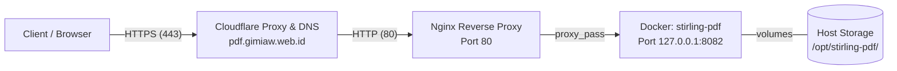

</details>

1. **Cloudflare (Edge/DNS & SSL/TLS)**: Menangani manajemen domain `gimiaw.web.id`, proxy CDN, perlindungan DDoS, dan terminasi SSL/TLS (HTTPS) secara gratis tanpa perlu setup certbot manual di server.
2. **Nginx (Host Reverse Proxy)**: Menerima trafik HTTP (port 80) dari Cloudflare, meneruskan request ke port lokal container, serta mengatur batas ukuran payload unggahan (`client_max_body_size`) dan timeout pemrosesan.
3. **Docker Engine & Compose (Container Runtime)**: Mengisolasi aplikasi Stirling-PDF beserta dependensinya (Java runtime, LibreOffice headless, dan daemon unoserver) di lingkungan kontainer terisolasi yang di-bind ke loopback interface host (`127.0.0.1:8082`).

### Prasyarat
- **Server/VPS**: Ubuntu 24.04 LTS (RAM 2 GB, CPU 1-2 vCPU, Disk sisa minimal 10 GB)
- **Akses**: Root / Sudo melalui SSH
- **Software**: Docker Engine, Docker Compose Plugin, Nginx Web Server
- **Akun & Domain**: Domain aktif di Cloudflare (`gimiaw.web.id`)

### Langkah Instalasi

#### 1. Setup DNS & SSL di Cloudflare
1. Masuk ke dashboard Cloudflare dan buka menu domain `gimiaw.web.id`.
2. Masuk ke tab **DNS** > **Records**, lalu tambahkan A Record baru:
   - **Type**: `A`
   - **Name**: `pdf`
   - **IPv4 Address**: `<IP_PUBLIC_VPS>` (misal: `43.133.129.209`)
   - **Proxy Status**: `Proxied` (awan oranye aktif untuk enkripsi otomatis dan proteksi IP)
3. Masuk ke tab **SSL/TLS** > **Overview**, pastikan enkripsi diatur ke mode **Flexible** (koneksi klien ke Cloudflare terenkripsi HTTPS, koneksi Cloudflare ke VPS via port 80 HTTP).

#### 2. Persiapan Server & Instalasi Docker + Nginx
Jalankan di terminal VPS:
```bash
# Update sistem dan install dependencies
apt update && apt upgrade -y
apt install -y docker.io docker-compose-v2 nginx curl
systemctl enable --now docker nginx
```

#### 3. Setup Struktur Direktori & Persistensi
```bash
mkdir -p /opt/stirling-pdf/trainingData \
         /opt/stirling-pdf/extraConfigs \
         /opt/stirling-pdf/customFiles \
         /opt/stirling-pdf/logs
cd /opt/stirling-pdf
```

#### 4. Pembuatan File `docker-compose.yml`
```bash
cat << 'EOF' > /opt/stirling-pdf/docker-compose.yml
services:
  stirling-pdf:
    image: frooodle/s-pdf:latest
    container_name: stirling-pdf
    ports:
      - '127.0.0.1:8082:8080'
    volumes:
      - ./trainingData:/usr/share/tessdata
      - ./extraConfigs:/configs
      - ./customFiles:/customFiles
      - ./logs:/logs
    environment:
      - DOCKER_ENABLE_SECURITY=false
      - INSTALL_BOOK_AND_ADVANCED_HTML_OPS=false
      - LANGS=en_GB
    restart: unless-stopped
EOF
```
*Catatan Port: Port aplikasi dalam container (`8080`) diekspos hanya ke loopback lokal host (`127.0.0.1:8082`). Ini mencegah akses langsung dari luar tanpa melewati Nginx proxy.*

#### 5. Menjalankan Container
```bash
cd /opt/stirling-pdf
docker compose up -d
```

---

## Konfigurasi

### 1. Reverse Proxy Nginx & Penyesuaian Upload Limit
Agar aplikasi dapat diakses via subdomain `pdf.gimiaw.web.id` dan mampu mengolah berkas PDF berukuran besar, konfigurasi Nginx diterapkan dengan batas body request hingga 100 MB:

```bash
cat << 'EOF' > /etc/nginx/sites-available/pdf.gimiaw.web.id
server {
    listen 80;
    server_name pdf.gimiaw.web.id;

    # Batas ukuran upload dokumen PDF
    client_max_body_size 100M;

    location / {
        proxy_pass http://127.0.0.1:8082;
        proxy_set_header Host $host;
        proxy_set_header X-Real-IP $remote_addr;
        proxy_set_header X-Forwarded-For $proxy_add_x_forwarded_for;
        proxy_set_header X-Forwarded-Proto $scheme;

        # Timeout dinaikkan agar konversi/OCR dokumen besar tidak putus
        proxy_read_timeout 300s;
        proxy_connect_timeout 300s;
    }
}
EOF

# Aktifkan konfigurasi dan reload service Nginx
ln -sf /etc/nginx/sites-available/pdf.gimiaw.web.id /etc/nginx/sites-enabled/
nginx -t && systemctl reload nginx
```

### 2. Konfigurasi Autentikasi (Akses Publik Tanpa Login)
Secara default pada versi terbaru (v3+), Stirling-PDF mewajibkan setup password admin saat pertama kali dijalankan. Untuk akses langsung tanpa sistem akun:

```bash
sed -i 's/enableLogin: true/enableLogin: false/g' /opt/stirling-pdf/extraConfigs/settings.yml
cd /opt/stirling-pdf && docker compose restart
```

### 3. Konfigurasi Dukungan Konversi Dokumen Office (DOCX, PPTX, Excel)
Untuk menjalankan konversi dokumen office ⇄ PDF, digunakan image varian standar (`frooodle/s-pdf:latest`) yang sudah memuat paket LibreOffice headless dan unoserver daemon. Dukungan ini memakan alokasi swap saat konversi berjalan di VPS 2 GB RAM.

## Cara Pemakaian
## Cara Pemakaian

### Tampilan Aplikasi Web
<!-- Diisi anggota lain -->

### Fungsi-Fungsi Utama
<!-- Diisi anggota lain -->

### Contoh Penggunaan Fitur

Bagian ini menunjukkan cara memakai lima fitur Stirling-PDF dengan file contoh (dummy). Semua langkah dilakukan lewat browser di https://pdf.gimiaw.web.id/.

#### 1. Merge (Menggabungkan PDF)

Digunakan untuk menggabungkan beberapa file PDF menjadi satu. File contoh: `laporan-bab1.pdf`, `laporan-bab2.pdf`, dan `laporan-bab3.pdf`.

1. Buka menu **Merge** pada halaman utama.

> 📸 **SCREENSHOT 1: Halaman utama, menu Merge dipilih**

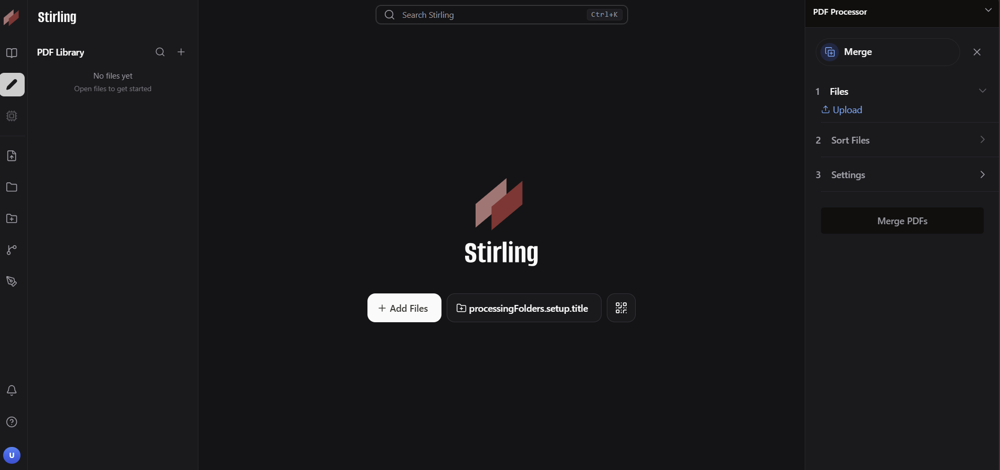

2. Unggah ketiga file PDF, lalu atur urutannya dengan *drag and drop* sesuai urutan bab.

> 📸 **SCREENSHOT 2: Tiga file sudah diunggah dan urutannya diatur**

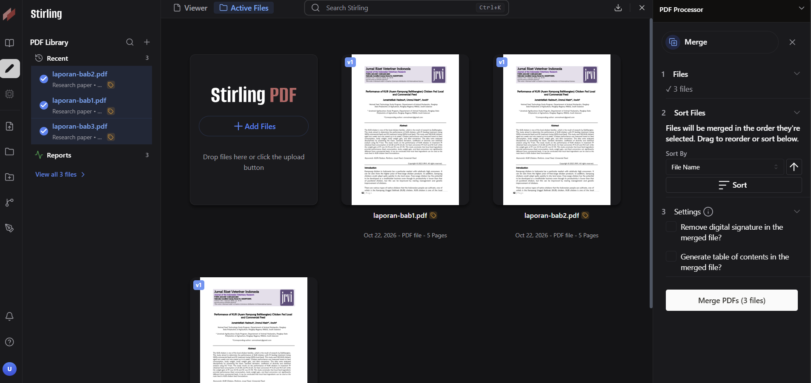

3. Klik tombol **Merge**, lalu unduh hasilnya.

> 📸 **SCREENSHOT 3: Hasil merge (file gabungan) dan jumlah halamannya**

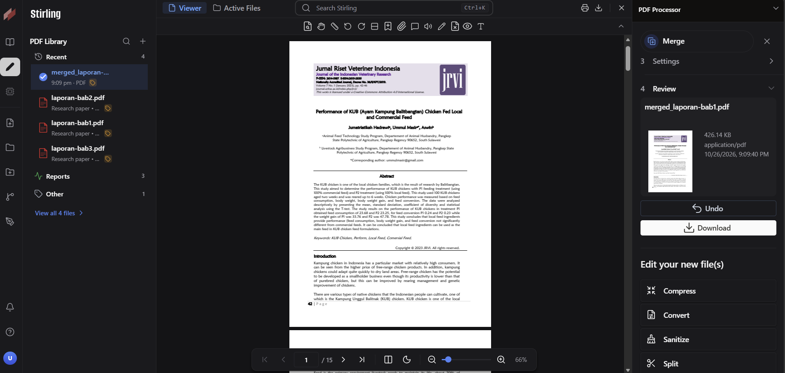

**Hasil:** tiga file digabung menjadi satu file PDF berurutan.

#### 2. Split (Memisahkan PDF)

Digunakan untuk memecah satu PDF menjadi beberapa file berdasarkan nomor halaman. File contoh: `laporan-lengkap.pdf` (misal 10 halaman).

1. Buka menu **Split** dan unggah `laporan-lengkap.pdf`.
2. Pada kolom nomor halaman, isi titik pemisahan, misalnya `3,7` agar file terpecah menjadi halaman 1-3, 4-7, dan 8-10.

> 📸 **SCREENSHOT 4: Menu Split dengan file terunggah dan kolom halaman terisi `3,7`**

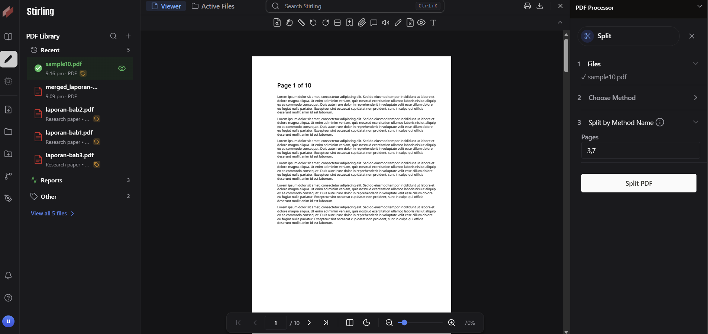

3. Klik **Split**, lalu unduh hasilnya (biasanya berupa file ZIP).

> 📸 **SCREENSHOT 5: Hasil split (daftar file keluaran, atau isi ZIP setelah di-extract)**

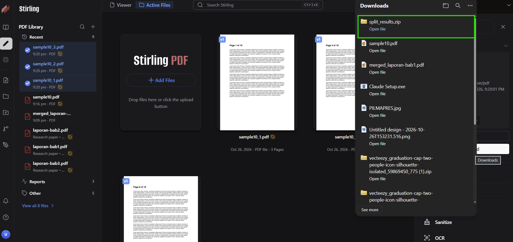

**Hasil:** satu PDF terpecah menjadi tiga file terpisah.

#### 3. Compress (Mengompres PDF)

Digunakan untuk memperkecil ukuran file PDF agar lebih mudah dikirim. File contoh: `presentasi-besar.pdf` (misal 15 MB).

1. Buka menu **Compress** dan unggah file.
2. Pilih tingkat kompresi (level lebih tinggi berarti ukuran lebih kecil, tetapi kualitas gambar menurun).

> 📸 **SCREENSHOT 6: Menu Compress dengan file terunggah dan level kompresi dipilih (tampilkan ukuran awal file)**

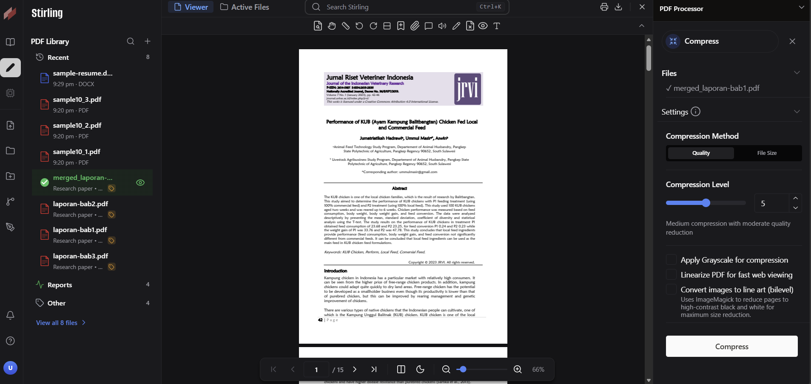

3. Klik **Compress**, lalu bandingkan ukuran file sebelum dan sesudah.

> 📸 **SCREENSHOT 7: Perbandingan ukuran file sebelum dan sesudah kompresi (Properties file atau tampilan di aplikasi)**

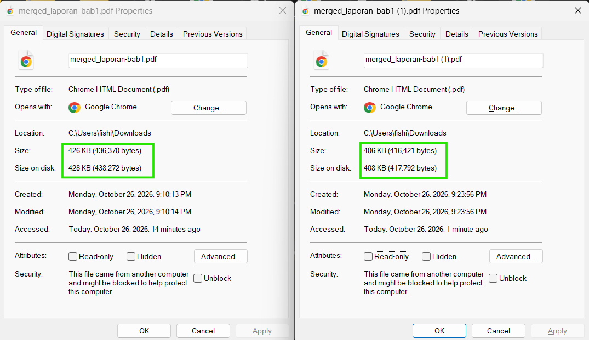

**Hasil:** ukuran file berkurang dari 426 KB menjadi 406 KB (isi sesuai hasil percobaan).

#### 4. Convert (Word ke PDF)

Digunakan untuk mengonversi dokumen Office ke PDF (fitur ini memakai LibreOffice di dalam container). File contoh: `surat-contoh.docx`.

1. Buka menu **Convert**, pilih konversi dari **Word/Document** ke **PDF**.
2. Unggah `surat-contoh.docx`.

> 📸 **SCREENSHOT 8: Menu Convert dengan pilihan format asal (DOCX) dan tujuan (PDF)**

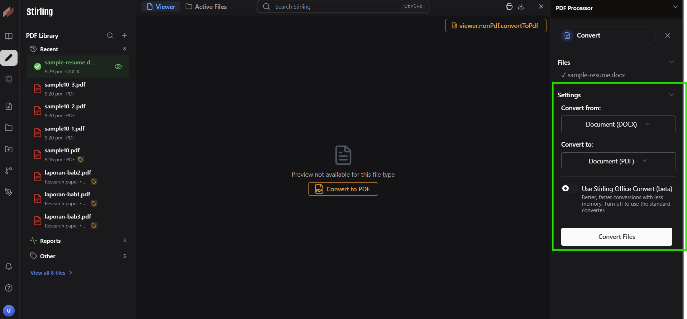

3. Klik **Convert**, lalu buka file PDF hasilnya.

> 📸 **SCREENSHOT 9: Hasil PDF yang sudah dibuka (tampilan sama dengan dokumen Word asli)**

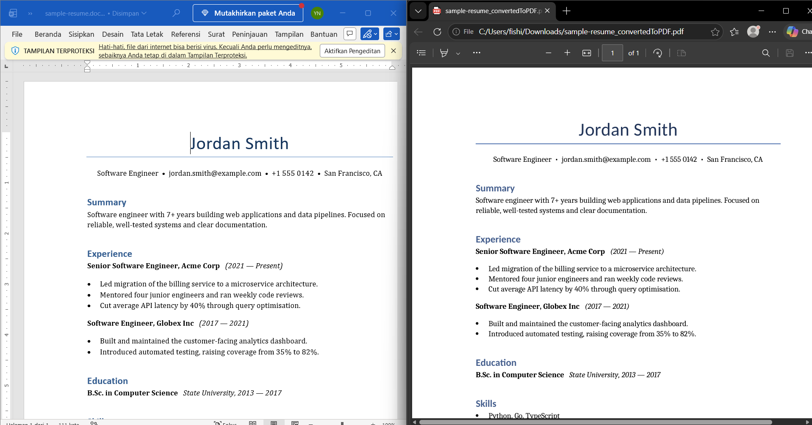

**Hasil:** dokumen Word berhasil menjadi PDF dengan tata letak tetap terjaga.

#### 5. Add Watermark (Menambahkan Tanda Air)

Digunakan untuk menambahkan teks tanda air pada setiap halaman PDF. File contoh: `laporan-lengkap.pdf`.

1. Buka menu **Add Watermark** dan unggah file.
2. Isi teks watermark (misal `KELOMPOK 3 - IPB`), lalu atur ukuran font, rotasi, dan transparansi.

> 📸 **SCREENSHOT 10: Menu Add Watermark dengan teks dan pengaturan terisi**

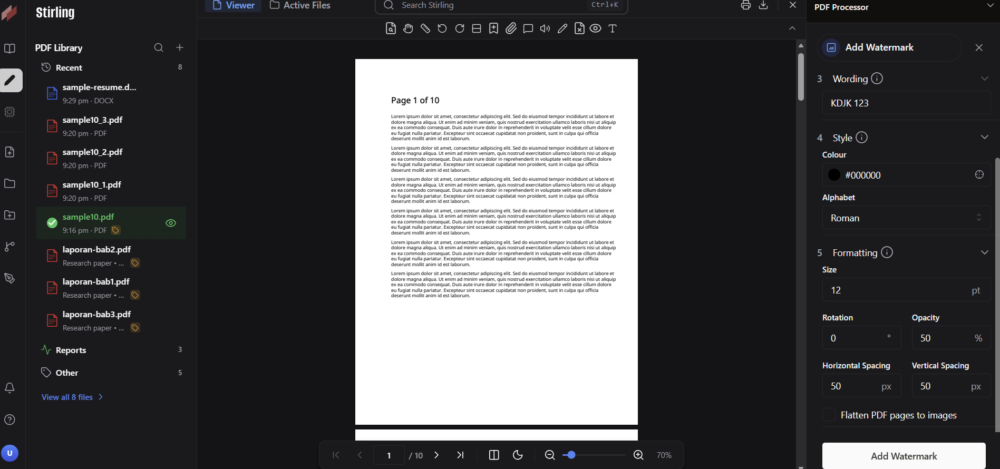

3. Klik **Add Watermark**, lalu unduh dan buka hasilnya.

> 📸 **SCREENSHOT 11: Halaman PDF hasil dengan watermark terlihat**

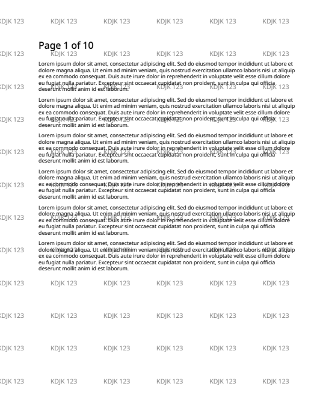

**Hasil:** teks watermark muncul di setiap halaman dokumen.

## Pembahasan
 
### Kelebihan
 
- **Gratis dan semua tool PDF dapat dipakai.** Menurut dokumentasi resmi, paket Free sudah mencakup seluruh tool PDF dan REST API. Paket berbayar hanya menambah fitur untuk skala organisasi, seperti SAML SSO, audit log, dan database eksternal.
- **Data tetap di server sendiri.** Dokumen tidak diunggah ke layanan pihak ketiga, sehingga cocok untuk dokumen yang sensitif.
- **Tidak ada kuota tugas harian; batas ukuran mengikuti konfigurasi server.** Berbeda dengan layanan online gratis seperti iLovePDF.
- **Fitur lengkap.** Ada 50+ operasi PDF, antara lain *merge*, *split*, kompresi, konversi dari/ke format Office, OCR, tanda tangan, dan *redact*.
- **Pemasangan relatif mudah.** Cukup satu *container* Docker tanpa database eksternal, dan komunitasnya besar (sekitar 89 ribu *stars* di GitHub) sehingga panduan mudah ditemukan.

### Kekurangan
 
- **Harus dikelola sendiri.** Pemasangan, pembaruan, *backup*, dan keamanan server menjadi tanggung jawab kita.
- **Cukup berat untuk server kecil.** Aplikasinya berbasis Java sehingga membutuhkan sekitar 1-2 GB RAM atau lebih, dan varian *fat* (dengan LibreOffice dan OCR) disarankan minimal 2 GB.
- **Ada batas 5 akun pada paket Free.** Batas ini berlaku bila menggunakan mode multi-user.
- **Keamanan perlu diatur.** Pada beberapa panduan, instalasi awal berjalan tanpa login dan memakai kredensial bawaan, sehingga perlu diamankan sebelum dibuka ke internet.
- **Hanya untuk PDF.** Kebutuhan gambar, video, atau audio memerlukan aplikasi lain.
 
### Perbandingan dengan Aplikasi Sejenis
 
| Aspek | Stirling-PDF | SnapOtter | iLovePDF |
|---|---|---|---|
| **Jenis layanan** | *Self-hosted* | *Self-hosted* | Layanan web (online) |
| **Cakupan** | Khusus PDF | Gambar, video, audio, PDF, dan file umum | Khusus PDF |
| **Privasi data** | File diproses di server sendiri | File diproses di server sendiri | File diunggah ke server iLovePDF dan dihapus otomatis setelah beberapa jam |
| **Biaya** | Gratis; biaya hanya server. Ada paket berbayar untuk tim besar | Gratis (AGPLv3); biaya hanya server | Gratis dengan batasan; *Premium* berbayar |
| **Batasan** | Tanpa login, tidak ada batas pengguna; 5 akun jika login bawaan diaktifkan | Tergantung server | Dibatasi jumlah tugas dan ukuran file di paket gratis |
| **Kebutuhan server** | Sekitar 1-2 GB RAM | Minimal 1 GB RAM dan 5 GB disk | Tidak perlu server |
| **Komunitas** | Sangat besar (± 89 ribu *stars*) | Masih kecil (± 2,2 ribu *stars*), proyek baru | Layanan komersial mapan |
| **Kemudahan** | Perlu setup awal | Perlu setup awal | Paling mudah, langsung buka browser |
 
## Kesimpulan
 
- **Stirling-PDF cocok jika** kita ingin mengolah PDF tanpa batas dengan data tetap di server sendiri dan ada server yang bisa dikelola. **Tetapi jika** tidak ada server atau tidak ingin repot merawatnya, iLovePDF lebih praktis dengan konsekuensi file diunggah ke pihak ketiga dan ada batasan pemakaian.
- **Stirling-PDF lebih baik daripada SnapOtter jika** fokusnya hanya PDF dan kita ingin aplikasi yang matang dengan komunitas besar. **Tetapi jika** kita butuh satu platform untuk banyak jenis file (gambar, video, audio), SnapOtter lebih sesuai.

## Referensi
 
1. https://github.com/Stirling-Tools/Stirling-PDF
2. https://docs.stirlingpdf.com/Server/Licensing/Plans-and-Licences/
3. https://docs.stirlingpdf.com/Modes%20and%20Licensing
4. https://railway.com/deploy/stirling
5. https://hub.docker.com/r/snapotter/snapotter
6. https://dinao.com/conteneur/snapotter
7. https://www.opentechhub.io/snapotter/
8. https://www.switchlabs.dev/compare/pdf-to-word-vs-ilovepdf
9. https://us.fitgap.com/products/ilovepdf
10. https://dev.to/vikasprogrammer/self-hosting-stirling-pdf-in-2026-i-ditched-adobe-and-smallpdf-1pd9
